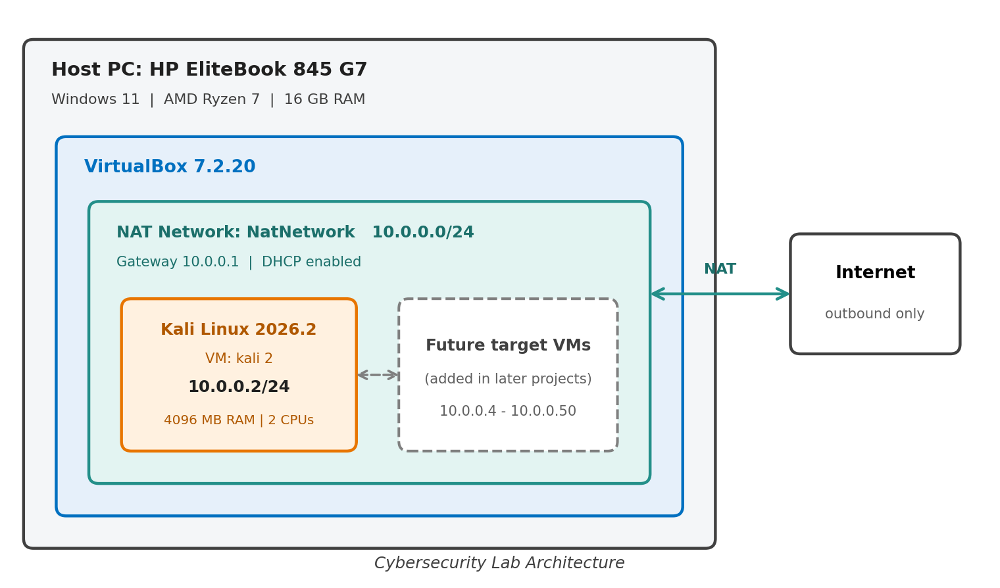
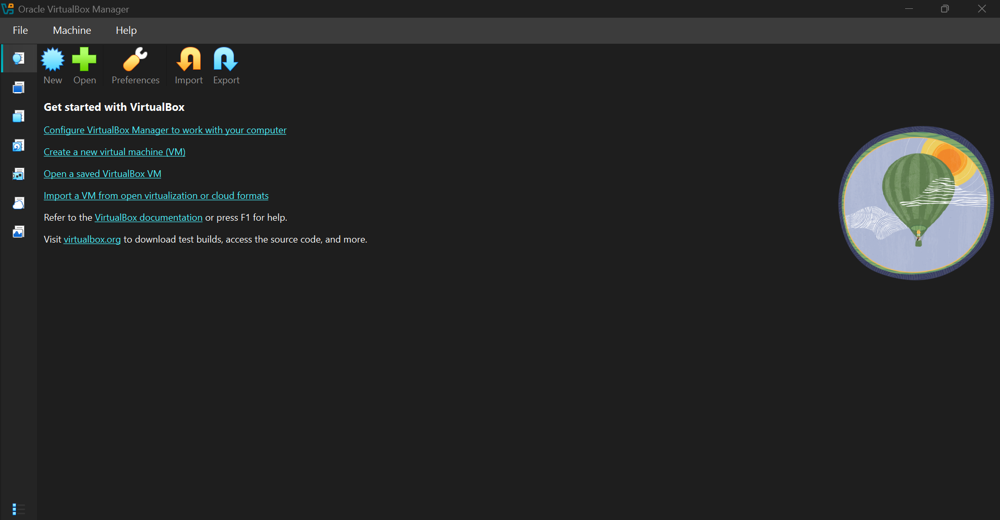
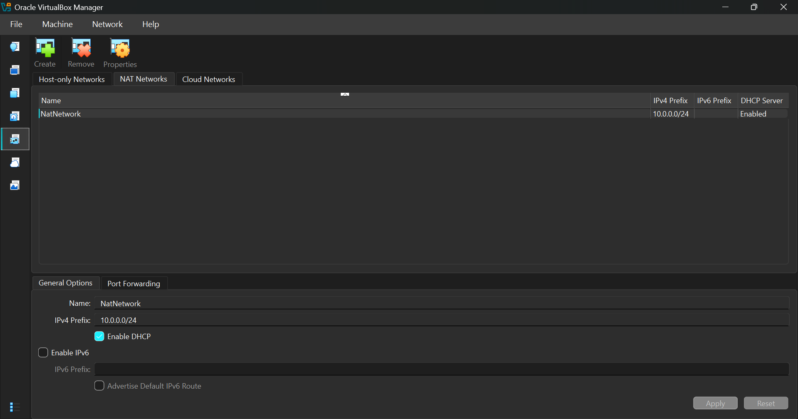
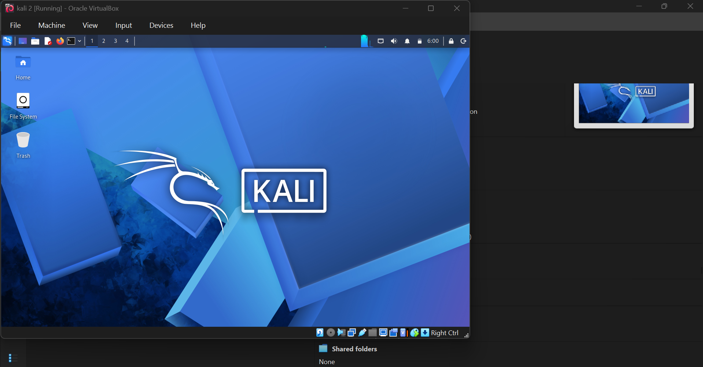
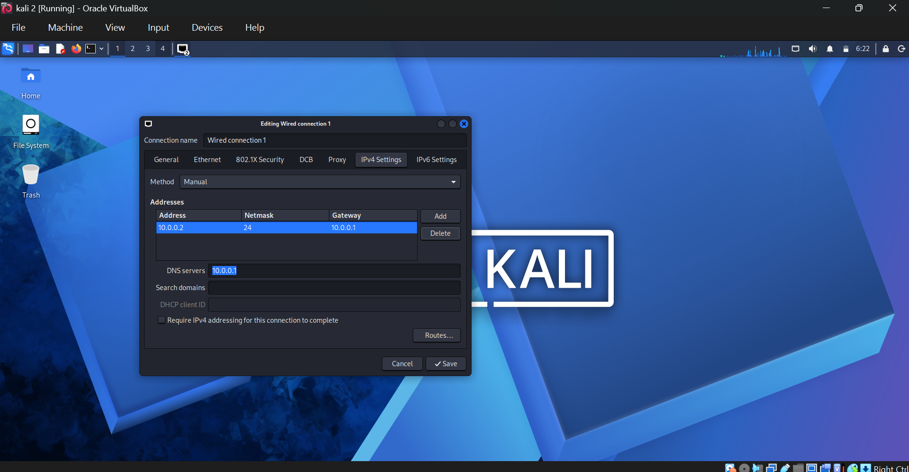

<div align="center">

# 🔐 Cybersecurity Lab Environment Setup

**Building an isolated virtual lab for penetration testing and ethical hacking practice**
</div>

<p align="center">
  
  
  
  
  
  
  
  
</p>

---

## 📌 Project Overview

This project sets up a **virtual cybersecurity and penetration-testing laboratory** using VirtualBox and Kali Linux.

The lab is a controlled environment where security tools, network scanning, reconnaissance and vulnerability assessment can be practiced safely and repeatedly.

It runs on a private virtual network so more machines can be added later and used as targets for authorized testing.

---

## 🎯 Objectives

- Install and configure VirtualBox.
- Install/import Kali Linux as a virtual machine.
- Create a private **NAT Network** for the lab.
- Configure network connectivity for Kali Linux.
- Assign a consistent IP address to the Kali VM.
- Verify network connectivity and DNS resolution.
- Document the complete setup process.
- Prepare the environment for future cybersecurity projects.

---

## 🛡️ Purpose of the Lab

The lab provides an isolated environment for learning and authorized security testing, for example:

- Network reconnaissance
- Port scanning
- Vulnerability assessment
- Packet analysis
- Web security testing
- Security-tool experimentation

⚠️ **Important:** Use this lab only on systems you own or have explicit permission to test.

---

## 🏗️ Lab Architecture



<!-- TODO: add your own diagram: Host PC -> VirtualBox -> NAT Network -> Kali VM (and future targets) -->

Additional target machines can be added to the same virtual network in future projects.

---

## ⚙️ Lab Configuration

| 🧩 Component       | ⚙️ Configuration        |
| ------------------ | ----------------------- |
| 🖥️ Host OS         | Windows 11              |
| 🧠 Host RAM        | 16 GB                  |
| ⚡ Processor       | AMD Ryzen 7 (HP EliteBook 845 G7) |
| 🧰 Hypervisor      | VirtualBox 7.2.20      |
| 🐉 Security OS     | Kali Linux 2026.2      |
| 🧠 Kali RAM        | 4096 MB               |
| 🌐 Virtual Network | NAT Network             |
| 📡 Network Address | 10.0.0.0/24           |
| 🐧 Kali IP Address | 10.0.0.2/24           |
| 🚪 Default Gateway | 10.0.0.1              |
| 🌍 DNS Server      | 10.0.0.1              |
| 🔮 Future VM Range | 10.0.0.4–10.0.0.50     |

---

# 🪜 Lab Setup Procedure

## Step 1. Install 7-Zip

7-Zip is used to extract the Kali Linux VM package, which is distributed as a `.7z` archive.

## Step 2. Install VirtualBox

VirtualBox was installed as the hypervisor.



## Step 3. Create the NAT Network

A dedicated NAT Network was created in VirtualBox.

```text
Network Name: NatNetwork
IPv4 Prefix:  10.0.0.0/24
DHCP:         Enabled
IPv6:         Disabled
```



A **NAT Network** lets multiple VMs on the same virtual network talk to each other while still having outbound Internet access, which suits future attacker and target VMs.

## Step 4. Import Kali Linux

The Kali Linux VM was downloaded from the official Kali website and imported into VirtualBox.

```text
Adapter 1
Attached to:  NAT Network
Network:      NatNetwork
Adapter Type: Intel PRO/1000 MT Desktop

RAM: 4096 MB
```




## Step 5. Configure the Kali Linux Network

```text
IP Address: 10.0.0.2
Subnet Mask: 255.255.255.0
Gateway: 10.0.0.1
DNS: 10.0.0.1
```

A consistent IP address makes the lab easier to document and reference.



---

# 🔎 Lab Verification

| ✅ Test                        | 🧾 Command                      | 🎯 Expected Result              |
| ----------------------------- | ------------------------------- | ------------------------------- |
| 🌐 Check IP address           | `ip a`                          | Correct Kali IP displayed       |
| 📡 Test gateway               | `ping 10.0.0.1`           | Successful replies              |
| 🌍 Test Internet connectivity | `ping 8.8.8.8`                  | Successful replies              |
| 🔎 Test DNS resolution        | `nslookup google.com`            | Domain resolves                 |
| 🧰 Verify Nmap                | `nmap --version`                | Nmap version displayed          |

### Results

```text
IP Address:
10.0.0.2/24

Gateway:
10.0.0.1

DNS:
10.0.0.1
```

---

# 🐞 Problems Encountered & Solutions

Documenting problems is an important part of the project.

## Problem 1. Network Connectivity Issue

**Symptom:** After setting up the Kali VM on the lab network, it had a network connectivity problem.

**Solution:** The fix was to make sure all the configurations were correct and matched each other:

- In VirtualBox, the Kali adapter is attached to the **NAT Network** `NatNetwork`.
- In Kali, the IPv4 method is set to **Manual** with the details below.
- The address and gateway sit inside the NAT Network prefix `10.0.0.0/24`.

```text
IP Address: 10.0.0.2
Netmask:    24 (255.255.255.0)
Gateway:    10.0.0.1
DNS:        10.0.0.1
```

After correcting the settings, connectivity was tested again with the verification commands above and everything worked.

> **Lesson:** If a VM has no network, first check that the VirtualBox adapter and the settings inside the VM agree with each other.

---

# 💡 What I Learned

Through this project, I learned how to build and troubleshoot a virtual environment for cybersecurity practice.

### 1. NAT vs NAT Network

A normal NAT adapter gives each VM its own private connection to the Internet, so VMs cannot see each other. A **NAT Network** puts several VMs on one shared virtual network (`NatNetwork`, `10.0.0.0/24`) where they can talk to each other and still reach the Internet. This is why NAT Network is the right choice for a lab with an attacker machine and future target machines.

### 2. Virtual Machine Networking

The VirtualBox settings and the settings inside the VM must agree. The adapter has to be attached to the correct network, and the VM's IP address, gateway and DNS must belong to that network. When one side does not match the other, the VM has no connectivity.

### 3. Static IP Configuration

I learned how to set a manual IPv4 address in Kali (`10.0.0.2/24`, gateway `10.0.0.1`, DNS `10.0.0.1`) and how to verify it with `ip a`, `ping` and `nslookup`. A fixed address makes the lab easier to document, and I planned `10.0.0.4–10.0.0.50` for future target machines.

### 4. Troubleshooting and Documentation

The network problem was solved by checking each configuration step by step instead of guessing. Writing down the settings, screenshots, test results and the problem I hit makes the lab repeatable and is an important part of professional cybersecurity work.

---

# 🔐 Security & Ethical Use

This laboratory is intended strictly for educational purposes and authorized testing.

---

# 🔗 Tools & Resources

- **7-Zip:** https://7-zip.org/download.html
- **VirtualBox:** https://virtualbox.org/wiki/Downloads
- **Kali Linux:** https://kali.org/get-kali

---

# 👤 Author

**Brian Lekasi**\
Cybersecurity Intern / NW-83X1P

LinkedIn: [https://www.linkedin.com/in/brian-lekasi-1bba34426](https://www.linkedin.com/in/brian-lekasi-1bba34426)

---

## 📌 Project Information

**Program Name:** Cybersecurity at Networkwalks | **Week:** 01 | **Project:** Cybersecurity & Pentesting Lab Setup | **Repository:** GitHub
